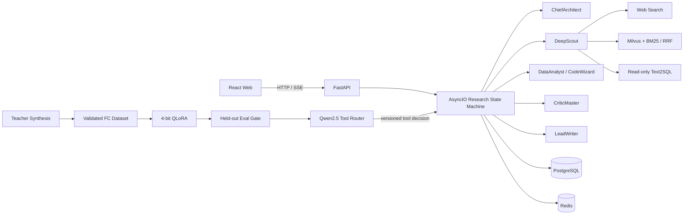

# DeepResearch Multi-Agent

面向复杂行业调研的多智能体研究系统。系统通过自研 AsyncIO 状态机调度规划、检索、
数据分析、图表生成、质量审查与报告写作，支持 Web、企业知识库和只读数据库三类数据源，
最终生成可追溯引用的研究报告。

本仓库同时包含在线研究系统和 Qwen2.5-7B 工具路由模型的数据合成、QLoRA 训练、
离线评测与推理服务，二者共享同一份版本化工具 Schema。

> 项目中的样本数量和模型准确率必须来自实际数据 Manifest 与评测报告；仓库不会写入
> 预设的训练结果。

## 核心能力

- **多 Agent 编排**：ChiefArchitect、DeepScout、DataAnalyst、CodeWizard、
  CriticMaster、LeadWriter 六个角色共享 `ResearchState`，由 AsyncIO 状态机统一控制。
- **多源并发研究**：按请求能力选择 Web Search、Local RAG、Text2SQL，并继续执行数据
  分析和图表生成；Text2SQL 只允许访问服务端登记的只读数据库配置。
- **检索与证据**：Milvus 向量检索与 Elasticsearch BM25 并发召回，通过加权 RRF 融合；
  单路异常时自动使用另一条检索链。
- **评审返工**：Critic 对事实、完整性、推理、引用和可用性进行审查；服务端同时执行
  确定性质量门禁，覆盖不足进入补搜，其余问题进入定向修订；达到轮次上限仍未过门禁时
  任务以质量失败结束，不会伪装成完成。
- **可靠执行**：提供 checkpoint、取消、级联超时、指数退避重试、熔断、降级、幂等记录、
  搜索索引 Outbox 和死信任务人工重放。
- **长期记忆**：Fact 保存带来源和置信度的事实版本，Experience 从多轮 Critic 评审归纳
  触发条件、有效策略和结果；规划前混合召回会更新访问统计，并依据时效、频率和置信度
  自动进行冷热迁移，冷层高相关命中可恢复到热层。
- **SFT 闭环**：教师模型轨迹合成、脱敏、Schema 校验、质量过滤、SimHash 去重、难度分桶、
  QLoRA、独立测试集门禁和 Adapter 灰度发布组成完整流水线。
- **可观测性**：SSE 推送节点与工具事件，Prometheus 记录运行指标，OpenTelemetry 传播跨服务
  Trace Context，并保留结构化事件审计。

## 系统架构



在线主链只由 AsyncIO 状态机驱动：

```text
Planning
   └─ Researching: Web / LocalRAG / Text2SQL
        └─ Analyzing: statistics / chart
             └─ Writing
                  └─ Reviewing
                       ├─ evidence missing → Re-researching
                       ├─ other issues     → Revising
                       └─ accepted         → Completed
```

## 目录结构

```text
deepresearch-mutilagent/
├─ backend/                 FastAPI、AsyncIO 状态机、Agent、检索、记忆和容错
│  ├─ app/contracts/        在线工具路由契约
│  ├─ app/service/
│  │  ├─ deep_research_v2/  六 Agent 研究主链
│  │  ├─ retrieval/         Milvus + Elasticsearch/BM25 + RRF
│  │  ├─ tool_routing/      Adapter 调用、灰度与规则回退
│  │  ├─ resilience/        Retry、Circuit Breaker、DLQ、幂等
│  │  └─ research_memory/   Fact / Experience 长期记忆
│  ├─ evals/                报告规则指标、LLM Judge 和统计检验
│  └─ migrations/           PostgreSQL 增量 SQL
├─ frontend/                React 19 + TypeScript + Ant Design
├─ contracts/               权威工具 Schema
├─ training/                数据合成、QLoRA、评测、打包与推理服务
├─ observability/           Prometheus 规则及可观测配置
├─ docker/init-db/          新数据库初始化 SQL
├─ docs/                    架构、接口和九组改造说明
└─ docker-compose.yml       PostgreSQL、Redis、Milvus、ES、Backend、Tool Router
```

## 环境要求

- Docker Engine 24+ 和 Docker Compose v2
- 本地开发：Python 3.10/3.11、Node.js 18+、npm 9+
- 启用 QLoRA 训练或 Adapter 推理：支持 CUDA 的 NVIDIA GPU 及 Container Toolkit
- 可用的 OpenAI-compatible LLM Key 和 Web Search Key

## 快速启动

### 1. 准备配置

```bash
cp .env.example .env
cp backend/.env.example backend/.env
cp frontend/.env.example frontend/.env
cp training/.env.example training/.env
```

至少需要配置：

- 根目录 `.env`：`POSTGRES_PASSWORD`、`MINIO_ROOT_USER`、`MINIO_ROOT_PASSWORD`
- `backend/.env`：同一组基础设施口令、`JWT_SECRET_KEY`、LLM Key、搜索 Key
- `frontend/.env`：开发环境 API 地址
- `training/.env`：合成数据时填写 `LLM_KEYS`；启用路由服务时填写内部 Token

`POSTGRES_PASSWORD` 和 MinIO 凭据在根目录与 `backend/.env` 中必须保持一致。

### 2. 启动在线服务

```bash
docker compose up -d postgres redis etcd minio milvus elasticsearch backend
docker compose ps
curl http://localhost:8000/hello
```

首次创建 PostgreSQL 数据卷时，`docker/init-db/` 会依序建立基础表、可靠性表和长期记忆表。
如果使用的是已经初始化过的旧数据卷，需要手动执行：

```bash
docker compose exec -T postgres psql -U postgres -d industry_assistant \
  -f /dev/stdin < backend/migrations/20261020_reliability.sql
docker compose exec -T postgres psql -U postgres -d industry_assistant \
  -f /dev/stdin < backend/migrations/20261020_research_memory.sql
docker compose exec -T postgres psql -U postgres -d industry_assistant \
  -f /dev/stdin < backend/migrations/20261031_memory_lifecycle.sql
```

后端 API 文档：<http://localhost:8000/docs>

### 3. 启动前端

```bash
cd frontend
npm install --legacy-peer-deps
npm run dev
```

访问 <http://localhost:5183>。

## 工具路由训练与发布

以下命令在 `training/` 下执行。完整参数见
[`training/docs/操作手册.md`](training/docs/操作手册.md)。

### 1. 同步并校验工具契约

```bash
cd training
python scripts/sync_tool_schema.py \
  --source ../contracts/deepresearch_tools.v1.json \
  --destination config/deepresearch_tools.v1.json
python scripts/sync_tool_schema.py \
  --source ../contracts/deepresearch_tools.v1.json --check
```

### 2. 合成并构建数据集

```bash
python scripts/expand_seed_questions.py \
  --input data/reviewed_seeds.jsonl \
  --output data/expanded_seeds.jsonl --target 6500

python scripts/synthesize_routing_trajectories.py \
  --seed-file data/expanded_seeds.jsonl \
  --output data/raw/teacher-trajectories.jsonl \
  --target-valid 6000 --workers 8

python scripts/build_dataset.py \
  --input data/raw/teacher-trajectories.jsonl \
  --output-dir data/routing-v1 \
  --target-valid 5000 --min-quality 0.75
```

流水线会生成 `train.jsonl`、`dev.jsonl`、`test.jsonl` 和 `manifest.json`；同一父种子的
变体不会跨集合，避免评测泄漏。

### 3. QLoRA、评测与打包

```bash
python scripts/02_train.py \
  --train-data data/routing-v1/train.jsonl \
  --eval-data data/routing-v1/dev.jsonl \
  --model-path Qwen/Qwen2.5-7B-Instruct \
  --output-dir outputs

python scripts/evaluate_tool_router.py \
  --model Qwen/Qwen2.5-7B-Instruct \
  --adapter outputs/<run>/adapter \
  --eval-data data/routing-v1/test.jsonl \
  --baseline-result reports/baseline.json \
  --output reports/candidate.json \
  --min-tool-accuracy 0.90 --min-schema-validity 0.98

python scripts/package_release.py \
  --training-run outputs/<run> \
  --evaluation reports/candidate.json \
  --release-dir releases/current
```

打包脚本仅在评测门禁通过且 Schema 摘要一致时生成发布目录。

### 4. 启用 Adapter 灰度路由

确保 `training/releases/current/` 已生成，并在 `backend/.env` 与 `training/.env` 中配置相同的
`TOOL_ROUTER_API_TOKEN`。随后设置：

```dotenv
# backend/.env
TOOL_ROUTER_ENABLED=1
TOOL_ROUTER_BASE_URL=http://tool-router:8080
TOOL_ROUTER_GRAY_PERCENT=10
TOOL_ROUTER_MIN_CONFIDENCE=0.65
```

启动推理服务并重启后端：

```bash
docker compose --profile tool-router up -d tool-router
docker compose restart backend
curl http://localhost:8080/healthz
```

灰度按 `session_id` 稳定分桶。服务超时、低置信度、选择越权工具或参数未通过 Schema 时，
在线系统自动回退确定性规则路由。

## 测试

```bash
# Backend
cd backend
ruff check app evals scripts
pytest tests -q

# Training
cd ../training
ruff check src scripts tests
pytest tests -q

# Frontend
cd ../frontend
npm run lint
npm run typecheck
npm test
```

报告评测 CLI：

```bash
cd backend
python scripts/run_research_eval.py --help
```

评测实现与 `deepresearch-agent-main` 的口径对齐：规则层计算事实准确性、幻觉风险、
逻辑一致性、引用覆盖和主题完备性，并按 `25%/20%/20%/20%/15%` 聚合；
LLM-as-Judge 对事实准确、逻辑一致、引用质量、覆盖面和整体质量按 0–10 分评分，
最终按规则 `60%`、Judge `40%` 合成。`backend/evals/benchmarks/` 提供
ResearchBench 与 HotpotQA（EM/F1/pass@k）适配器，候选版本与基线通过配对
Bootstrap 95% CI、p-value 和 Cohen's d 进行发布门禁。

## 关键接口

| 接口 | 用途 |
|---|---|
| `POST /research/stream` | 启动研究并以 SSE 返回事件 |
| `POST /research/outline/{session_id}/approve` | 审核大纲后恢复执行 |
| `POST /research/cancel/{session_id}` | 取消长链路任务 |
| `POST /research/resume/{session_id}` | 从 checkpoint 恢复 |
| `GET /research-memories/search` | 检索 Fact/Experience 记忆 |
| `GET /reliability/dead-letters` | 查看死信任务 |
| `POST /reliability/dead-letters/{id}/replay` | 重放死信任务 |
| `POST /v1/tool-routing` | QLoRA 工具路由服务内部接口 |
| `GET /metrics` | Prometheus 指标 |

研究、记忆和可靠性管理接口需要 JWT；内部工具路由接口使用独立 Bearer Token。

## 数据与安全约束

- API Key、数据库 DSN、内部 Token 只通过环境变量注入，不提交到仓库。
- Text2SQL 不接受用户传入 DSN，仅使用 `TEXT2SQL_DATABASE_PROFILES` 中的只读连接。
- 合成数据在落盘前执行密钥、Bearer Token、DSN、邮箱、手机号和身份证号脱敏。
- `training/outputs`、`reports`、`releases` 和生成数据默认被 `.gitignore` 排除。
- 对旧数据卷执行迁移前应先备份；不要在生产环境设置 `DB_AUTO_CREATE=1`。

## 文档

- [九组依赖化改造说明](docs/implementation/9-pr-delivery.md)
- [架构总览](docs/architecture.md)
- [训练操作手册](training/docs/操作手册.md)
- [训练脚本说明](training/docs/脚本说明.md)

## License

许可证与使用限制见 [LICENSE](LICENSE)。
